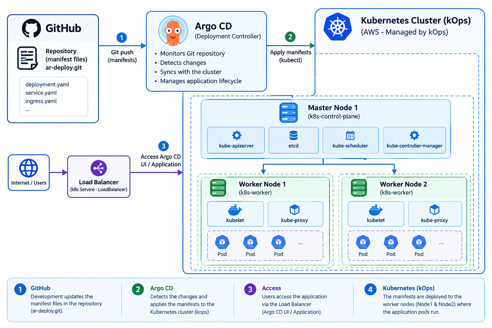
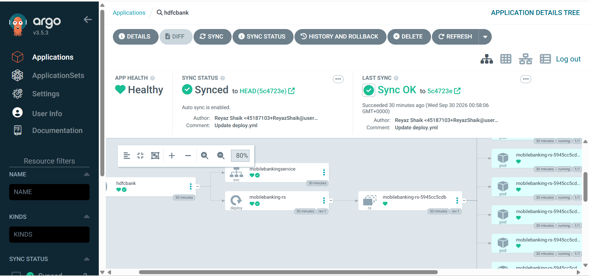
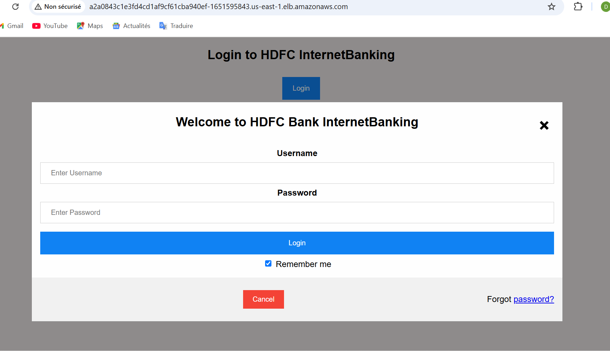

# Kubernetes GitOps Deployment with Argo CD & kOps on AWS

This repository demonstrates a **GitOps continuous delivery workflow** on AWS using **Argo CD** and **Kubernetes**, with the Kubernetes cluster provisioned and managed through **kOps**.

The project demonstrates how Git can be used as the **single source of truth** for Kubernetes application deployments, while Argo CD continuously monitors the repository and synchronizes the desired state with the Kubernetes cluster.

---

## 🏗️ Architecture Overview

The GitOps workflow follows an automated declarative deployment model:

```text
                    GitHub
                      │
                      │ Git Push
                      ▼
                Argo CD
             GitOps Controller
                      │
                      │ Sync
                      ▼
             Kubernetes Cluster
                 AWS / kOps
                      │
             ┌────────┴────────┐
             │                 │
             ▼                 ▼
        Worker Node 1     Worker Node 2
             │                 │
             └────────┬────────┘
                      ▼
               Application Pods
                      │
                      ▼
             Kubernetes Service
                      │
                      ▼
                  Users
```

### Workflow

1. Developers or DevOps engineers push Kubernetes manifest changes to GitHub.
2. **Argo CD** continuously monitors the Git repository.
3. Argo CD detects differences between the Git repository and the Kubernetes cluster.
4. Argo CD synchronizes the desired state with the cluster.
5. Kubernetes creates or updates the application resources.
6. Users access the application through the configured Kubernetes Service.

---

# ☁️ Infrastructure Architecture

The Kubernetes infrastructure is provisioned on AWS using **kOps**.

```text
                         AWS
                          │
                         kOps
                          │
              ┌───────────┴───────────┐
              │                       │
              ▼                       ▼
        Control Plane            Worker Nodes
              │                ┌──────────────┐
              │                │ Worker 1     │
              │                │ Worker 2     │
              │                └──────┬───────┘
              │                       │
              ▼                       ▼
        Kubernetes API          Application Pods
        etcd
        Scheduler
        Controller Manager
```

The infrastructure uses:

* **EC2** for Kubernetes nodes
* **S3** for the kOps state store
* **IAM** for AWS permissions
* **Route 53** for DNS when required

---

# 🔄 GitOps Workflow

The complete deployment workflow is:

```text
Developer
    │
    │ git push
    ▼
GitHub Repository
    │
    │ Repository Monitoring
    ▼
Argo CD
    │
    │ Synchronization
    ▼
Kubernetes Cluster
    │
    ▼
Deployment
    │
    ▼
ReplicaSet
    │
    ▼
Application Pods
```

Git is therefore used as the **desired state**, while Kubernetes represents the **actual running state**.

Argo CD continuously helps keep both states synchronized.

---

# 🛠️ Tech Stack

## Infrastructure

| Component               | Technology |
| ----------------------- | ---------- |
| Cloud Provider          | AWS        |
| Compute                 | EC2        |
| Kubernetes Provisioning | kOps       |
| Kubernetes State Store  | Amazon S3  |
| Identity & Access       | IAM        |
| DNS                     | Route 53   |

## Kubernetes & GitOps

| Component               | Technology         |
| ----------------------- | ------------------ |
| Container Orchestration | Kubernetes         |
| GitOps                  | Argo CD            |
| Version Control         | Git / GitHub       |
| Configuration           | Kubernetes YAML    |
| Application Exposure    | Kubernetes Service |

---

# 📋 Prerequisites

Before starting, make sure the following tools are installed and configured:

* **AWS CLI**
* **kubectl**
* **kOps**
* **Git**
* **Argo CD CLI** *(optional)*

### AWS CLI

```bash
aws configure
```

Verify:

```bash
aws --version
```

### kubectl

```bash
kubectl version --client
```

### kOps

```bash
kops version
```

### Git

```bash
git --version
```

---

# 🚀 Step-by-Step Deployment

## 1. Provision the Kubernetes Cluster with kOps

Set the required environment variables:

```bash
export BUCKET_NAME=my-kops-state-store-bucket
export CLUSTER_NAME=mycluster.k8s.local
```

---

## 2. Create the kOps S3 State Store

Create the S3 bucket:

```bash
aws s3api create-bucket \
  --bucket $BUCKET_NAME \
  --region us-east-1
```

Set the kOps state store:

```bash
export KOPS_STATE_STORE=s3://$BUCKET_NAME
```

The state store is used by kOps to maintain the configuration and state of the Kubernetes cluster.

---

# ☸️ 3. Create the Kubernetes Cluster

Create the cluster configuration:

```bash
kops create cluster \
  --name=$CLUSTER_NAME \
  --state=s3://$BUCKET_NAME \
  --zones=us-east-1a \
  --node-count=2 \
  --node-size=t3.medium \
  --control-plane-size=t3.medium \
  --control-plane-zones=us-east-1a
```

This example creates:

```text
1 Control Plane
      +
2 Worker Nodes
```

Review the cluster configuration:

```bash
kops get cluster \
  --state=s3://$BUCKET_NAME
```

Apply the configuration:

```bash
kops update cluster \
  --name=$CLUSTER_NAME \
  --state=s3://$BUCKET_NAME \
  --yes \
  --admin
```

---

# 🔍 4. Verify the Kubernetes Cluster

Validate the cluster:

```bash
kops validate cluster \
  --state=s3://$BUCKET_NAME
```

Check the Nodes:

```bash
kubectl get nodes
```

Check the Nodes with additional information:

```bash
kubectl get nodes -o wide
```

Check all Pods:

```bash
kubectl get pods -A
```

---

# 🚀 5. Install Argo CD

Create the Argo CD namespace:

```bash
kubectl create namespace argocd
```

Install Argo CD:

```bash
kubectl apply \
  -n argocd \
  -f https://raw.githubusercontent.com/argoproj/argo-cd/stable/manifests/install.yaml
```

Verify the installation:

```bash
kubectl get pods -n argocd
```

The Argo CD components should progressively reach the:

```text
Running
```

state.

---

# 🌐 6. Expose Argo CD

For this project, Argo CD is exposed using a Kubernetes **LoadBalancer Service**.

Change the Argo CD server Service:

```bash
kubectl patch svc argocd-server \
  -n argocd \
  -p '{"spec": {"type": "LoadBalancer"}}'
```

Check the Service:

```bash
kubectl get svc -n argocd
```

The AWS Load Balancer address will appear in the `EXTERNAL-IP` or equivalent external endpoint field once provisioned.

---

# 🔐 7. Retrieve the Argo CD Admin Password

Retrieve the initial administrator password:

```bash
kubectl -n argocd get secret \
  argocd-initial-admin-secret \
  -o jsonpath="{.data.password}" | base64 -d
```

The default username is:

```text
admin
```

Use the Load Balancer endpoint to access the Argo CD web interface.

---

# 🔗 8. Connect GitHub to Argo CD

The Argo CD Application defines the relationship between:

```text
GitHub Repository
       │
       ▼
    Argo CD
       │
       ▼
Kubernetes Cluster
```

Example `argocd-application.yaml`:

```yaml
apiVersion: argoproj.io/v1alpha1
kind: Application
metadata:
  name: my-app
  namespace: argocd

spec:
  project: default

  source:
    repoURL: https://github.com/<your-username>/<your-repository>.git
    targetRevision: main
    path: .

  destination:
    server: https://kubernetes.default.svc
    namespace: default

  syncPolicy:
    automated:
      prune: true
      selfHeal: true
```

Apply the Application:

```bash
kubectl apply -f argocd-application.yaml
```

Check the Application:

```bash
kubectl get applications -n argocd
```

---

# 🔄 9. GitOps Synchronization

Once the Argo CD Application is configured, modify one of the Kubernetes manifests.

For example:

```yaml
spec:
  replicas: 3
```

Commit and push the change:

```bash
git add .
git commit -m "Scale application to 3 replicas"
git push origin main
```

Argo CD detects the change in Git and synchronizes the Kubernetes cluster.

Check the Pods:

```bash
kubectl get pods
```

You should see the number of replicas defined in Git reflected in Kubernetes.

---

# 📊 10. Application Verification

Check the Deployment:

```bash
kubectl get deployments
```

Check the Pods:

```bash
kubectl get pods -o wide
```

Check the Services:

```bash
kubectl get svc
```

Check a specific Service:

```bash
kubectl describe svc <service-name>
```

View application logs:

```bash
kubectl logs <pod-name>
```

---

# 🧠 GitOps Concepts Demonstrated

This project demonstrates the following concepts:

| Concept                      | Technology            |
| ---------------------------- | --------------------- |
| Cloud Infrastructure         | AWS                   |
| Kubernetes Provisioning      | kOps                  |
| Container Orchestration      | Kubernetes            |
| Continuous Delivery          | Argo CD               |
| GitOps                       | Argo CD + Git         |
| Version Control              | GitHub                |
| Infrastructure State         | Amazon S3             |
| AWS Identity                 | IAM                   |
| Application Deployment       | Kubernetes Deployment |
| Service Discovery / Exposure | Kubernetes Service    |
| Declarative Configuration    | YAML                  |
| Self-Healing                 | Argo CD               |

---

# 📂 Repository Structure

```text
Kubernetes-ArgoCD/
│
├── deployment.yaml
├── service.yaml
├── argocd-application.yaml
│
├── Architecture.png
├── ArgoDC.png
├── App-running.png
│
├── guide_de_deploiement_et_resolution_de_problemes.md
│
└── README.md
```

### File Description

| File                                                 | Description                          |
| ---------------------------------------------------- | ------------------------------------ |
| `deployment.yaml`                                    | Kubernetes Deployment                |
| `service.yaml`                                       | Kubernetes Service                   |
| `argocd-application.yaml`                            | Argo CD Application definition       |
| `Architecture.png`                                   | GitOps architecture diagram          |
| `ArgoDC.png`                                         | Argo CD dashboard screenshot         |
| `App-running.png`                                    | Running application screenshot       |
| `guide_de_deploiement_et_resolution_de_problemes.md` | Deployment and troubleshooting guide |
| `README.md`                                          | Main project documentation           |

---

# 📸 Project Screenshots

## Architecture



## Argo CD Dashboard



## Application Running



---

# 🔐 Best Practices

For a production environment:

* Restrict AWS Security Groups.
* Follow the principle of least privilege with IAM.
* Avoid storing credentials in Git.
* Use Kubernetes Secrets or a dedicated secrets-management solution.
* Use private repositories when appropriate.
* Protect Argo CD administrative access.
* Use HTTPS for production environments.
* Monitor AWS resource consumption.
* Regularly update Kubernetes and Argo CD versions.
* Separate development, staging, and production environments.

---

> **Note:** Ingress and HTTP/HTTPS routing are intentionally excluded from this project because they are covered in a separate Kubernetes Ingress project.

---

# 🧹 Cleanup

To avoid unnecessary AWS charges, delete the Kubernetes cluster when the lab is finished.

Delete the cluster:

```bash
kops delete cluster \
  --name=$CLUSTER_NAME \
  --state=s3://$BUCKET_NAME \
  --yes
```

Delete the kOps state store:

```bash
aws s3 rb s3://$BUCKET_NAME --force
```

> ⚠️ Make sure the S3 bucket contains only the kOps state for this lab before deleting it.


---

## 👨‍💻 Author

**Boubacar Djibrilla**

Technologies practiced:

**AWS · Kubernetes · kOps · Argo CD · GitOps · Docker · Linux · DevOps**

---

⭐ If you found this project useful, feel free to star the repository.
